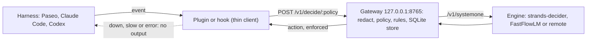
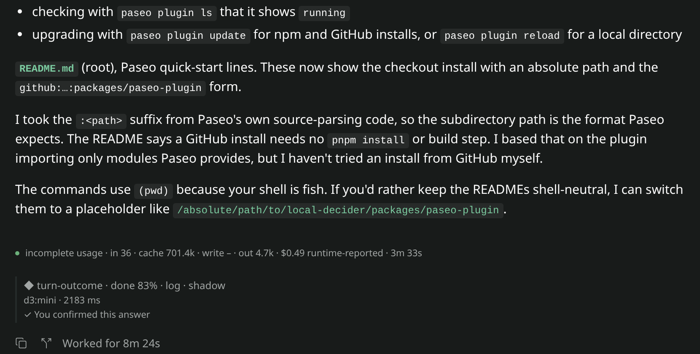
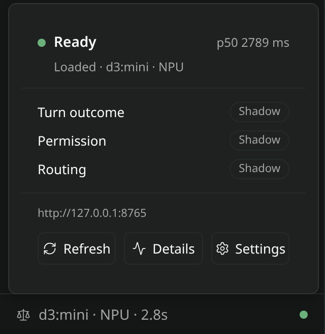
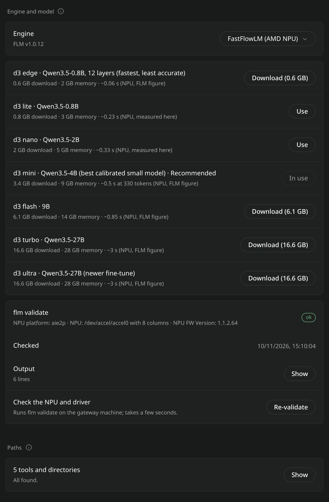
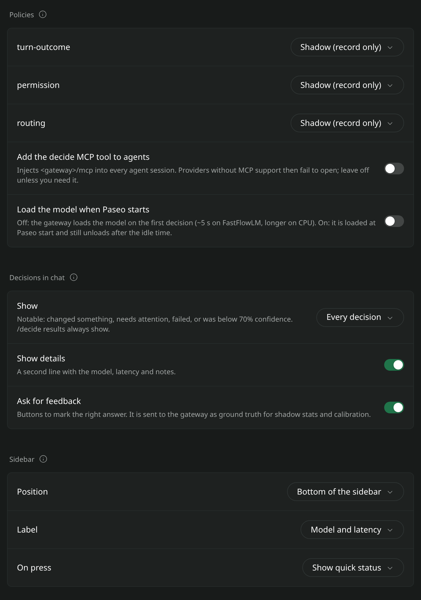
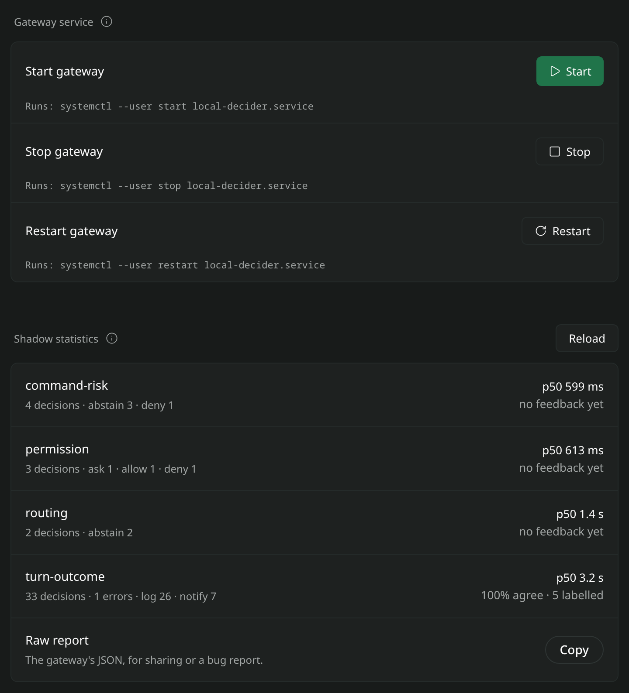

# local-decider

[](https://github.com/ziptie-soft/local-decider/actions/workflows/ci.yml)
[](https://github.com/ziptie-soft/local-decider/actions/workflows/codeql.yml)
[](https://github.com/ziptie-soft/local-decider/actions/workflows/osv.yml)
[](https://github.com/ziptie-soft/local-decider/actions/workflows/release.yml)
[](https://scorecard.dev/viewer/?uri=github.com/ziptie-soft/local-decider)
[](https://www.npmjs.com/package/@ziptie-soft/local-decider)
[](https://www.npmjs.com/package/@ziptie-soft/local-decider)
[](https://www.npmjs.com/package/@ziptie-soft/local-decider)
[](https://snyk.io/test/npm/@ziptie-soft/local-decider)
[](https://socket.dev/npm/package/@ziptie-soft/local-decider)
[](LICENSE)
[](https://savelife.in.ua/en/donate-en/)
[](https://www.sternenkofund.org/en/donate)
[](https://prytulafoundation.org/en/donation)


**Coding agents stop to ask you about routine things, or spend expensive model tokens deciding
them. local-decider lets a small decision model on your own machine answer the routine ones, and
leaves everything uncertain to you or to the large model.**

It works with [Paseo](https://paseo.sh), Claude Code and Codex.

> **Status:** early development, in daily use. Policies enforce in `act` mode: auto-allowing
> permission prompts, routing new agents to presets, flagging turns that need you. New installs
> start every policy in `shadow` mode (log what it would do) so you can measure before switching
> it to `act`.
>
> **Unofficial.** This project is not affiliated with, endorsed by, or sponsored by Strands
> Agents, Amazon Web Services, Anthropic, OpenAI or Paseo.

## What it is

A coding-agent harness keeps hitting small, fixed-choice questions. Can this `git status` run
without asking? Did the agent finish, or is it waiting for me? Does this task need the big model?
Is this command risky?

local-decider answers them with a local "System One" decision model. The model reads the state
once and returns a probability for each option, plus a calibrated confidence. A YAML **policy**
turns the answer into an action (`allow`, `ask`, `deny`, `notify`, `route:<preset>`, ...). Only
high-confidence answers act. Everything else falls through to the harness's normal behaviour.

A local **gateway** runs the model and the policies. Thin harness plugins call it over HTTP on
`127.0.0.1:8765`. If the gateway is down, slow or erroring, the plugins do nothing and the
harness behaves as if they were not installed.



See [docs/architecture.md](docs/architecture.md) for the full pipeline.

## What's in the monorepo

| Path | What it is |
|---|---|
| [`packages/core`](packages/core) | `@ziptie-soft/local-decider-core`: `/v1/systemone` types, policy schema and rules, redaction, truncation, gateway client |
| [`packages/gateway`](packages/gateway) | `@ziptie-soft/local-decider`: the local HTTP service, engine adapters, MCP server and CLI |
| [`packages/hooks`](packages/hooks) | The Claude Code and Codex hook runner, bundled into `plugins/local-decider/dist/local-decider-hook.mjs` at release and published to npm |
| [`packages/paseo-plugin`](packages/paseo-plugin) | `@ziptie-soft/paseo-plugin-local-decider`: the Paseo plugin, with settings, chat rows and sidebar status |
| [`plugins/local-decider`](plugins/local-decider) | One plugin directory for both Claude Code and Codex (both manifests) |
| [`policies/`](policies) | Default policies: `turn-outcome`, `permission`, `routing` (plus two variants), `command-risk`; fixtures in `policies/fixtures/` |
| [`schemas/`](schemas) | JSON Schemas for `config.yaml` and policy files |
| [`docs/`](docs) | Architecture, install, policies, security, benchmarks, ADRs |

## Benefits

- **Fewer prompts.** Read-only commands, builds, tests and in-project edits can be auto-allowed
  when the model is very sure (p(allow) ≥ 0.95 by default).
- **Cheaper routing.** A routing policy picks a preset such as `fast`, `cheap` or `deep` for a new
  task. You map each preset to a model, so small tasks can go to a cheaper one.
- **Private and local.** The model runs on your machine. Secrets are redacted before the model
  sees the state. The decision log stores hashes, never prompts or code.
- **Fails open.** A missing, slow or broken gateway changes nothing.
- **Measure before you enforce.** In `shadow` mode every decision is logged with what it *would*
  have done. `local-decider stats` reports agreement, Brier score, calibration buckets, advisory
  threshold hints and estimated savings; `--days N` selects a window from 1 day through the
  configured retention period (30 days by default). Switch a policy to `act` when the numbers
  look right.
- **Learns from your answers.** Exact-match precedent: after three verified allows of the same
  request in the same working directory, and no veto, a lower threshold (p ≥ 0.6) applies across
  supported harnesses. A decline is neutral unless you mark it unsafe; configured unverified
  classifier denials can only veto, never add allow evidence.
- **Supervised subagents in Paseo.** An orchestrator agent can answer its child's escalated
  permission request, and that answer counts as precedent. Paseo notifies the orchestrator
  before the decider has answered, so the orchestrator should wait and answer only what is still
  pending. See [docs/supervised-subagents.md](docs/supervised-subagents.md).
- **Policies are data.** Change questions, thresholds and actions in YAML, without code.

## Drawbacks and limits

Read [docs/security.md](docs/security.md) before you turn on `act`.

- **Small models make mistakes.** Calibration differs per model, so thresholds tuned on one model
  do not transfer. Re-check `local-decider stats` after switching models.
- **It needs local hardware.** The default 2B model downloads about 4.8 GB (E4B about 16.5 GB).
  FastFlowLM `d3:mini` downloads about 3.4 GB and needs about 9 GB of RAM.
- **Every decision costs latency.** On CPU the 2B model takes 1.2–2.5 s for a short decision.
  The hooks give up after 1.5 s, so on CPU the decider suits shadow logging, turn outcomes and
  routing hints, not a per-tool-call guard. d3-lite on an NPU or GPU is 10–17× faster (see
  [Results](#results)).
- **Prompts are untrusted input.** The model reads text an attacker may control. It cannot run
  anything, but it can be steered toward a label. That is why auto-allow needs p ≥ 0.95,
  `command-risk` can only add friction, permission hooks never auto-deny, and a deterministic deny
  layer runs first.
- **Redaction is best-effort** pattern matching. Unusual secret formats can reach the local
  engine (never the log).
- **User outcomes come from Paseo.** Plain Claude Code and Codex hooks cannot see your answer.
  The Claude Code auto-mode mod reports classifier denials as unverified vetoes, which can only
  add friction.
- **Harness limits.** Claude Code auto mode ignores a hook `allow`
  ([anthropics/claude-code#94740](https://github.com/anthropics/claude-code/issues/94740)), so
  there the decider can only add `ask` or `deny`. Codex `PreToolUse` is deny-only. Paseo auto
  mode still sends each action to the provider's hosted classifier first; the plugin saves
  prompts in Always Ask or Accept File Edits mode. Paseo 0.15.3 gives plugins no first prompt at
  agent creation, so routing sees only the agent title.
- **Shadow savings are an upper bound.** A cheaper model may need more turns or fail.
- **Outcome labels are not authenticated.** Any local process can post one to the loopback
  gateway.

## Quick start

Requirements:

- Node >= 24.15 for the gateway (Node 20+ is enough for the Claude Code and Codex hooks).
- [uv](https://docs.astral.sh/uv/) for the strands-decider engine.
- Linux or macOS. Optional: an AMD Ryzen AI NPU (FastFlowLM, Linux), Apple Silicon (MLX) or CUDA.

The commands below are fish-compatible. [docs/install.md](docs/install.md) has every option.

### 1. Gateway and engine

```sh
npm install --global @ziptie-soft/local-decider
local-decider engine install      # uv venv + weights; cpu on Linux, mlx on Apple Silicon
local-decider gateway start       # systemd user unit (Linux) or launchd agent (macOS)
local-decider gateway status
```

`engine install` takes `--flavor cpu|mlx|cuda`, `--model <id>` and `--no-download`. On Linux with
an AMD Ryzen AI NPU, install [FastFlowLM](https://github.com/FastFlowLM/FastFlowLM) yourself with
your package manager or its installer (local-decider never downloads it), then pull a model and
pick it in Paseo's settings:

```sh
local-decider engine install --engine fastflowlm --model d3:mini   # uses your flm: validate, pull
```

On Linux x86_64 with a hardware Vulkan GPU, install llama.cpp with its Vulkan backend yourself
(with mise, see [Engine prerequisites with mise](docs/install.md#engine-prerequisites-with-mise)),
then run `local-decider engine install --engine llama-vulkan --model d3-mini-q4_k_m`. The gateway
downloads only the pinned GGUF; set `tools.llamaServer` or `engines.llama-vulkan.binary` if the
server is not found on `PATH`.

Check that it answers:

```sh
local-decider decide turn-outcome lastMessage="All tests pass; the PR is open."
```

### 2. Paseo

Enable plugins on the daemon first (**Settings → Plugins → Enable plugins**), then:

```sh
paseo plugin install npm:@ziptie-soft/paseo-plugin-local-decider
paseo plugin ls                   # local-decider should show "running"
```

Open **Settings → Local decider** to pick the engine and model, and set each policy's mode.

### 3. Claude Code and Codex

```sh
claude plugin marketplace add ziptie-soft/local-decider; and claude plugin install local-decider@ziptie-soft
codex plugin marketplace add ziptie-soft/local-decider; and codex plugin add local-decider@ziptie-soft
```

For Codex, open the TUI and run `/hooks` to review and trust the hooks; Codex does not run
untrusted plugin hooks.

Inside Paseo, Claude Code and Codex agents load their plugin too. The Paseo plugin tells the
hooks which policies it already runs, so each event is decided once. See
[plugins/local-decider/README.md](plugins/local-decider/README.md).

## What it looks like

A decision row in a Paseo chat after a turn ends: answer, confidence, action, model, latency,
and feedback buttons.



<details>
<summary>More screenshots: quick status, settings, service and statistics</summary>

Quick status from the sidebar: engine state, latency and each policy's mode.



Engine and model picker with download sizes, memory, latency and the FastFlowLM NPU check.



Policy modes, how decisions show in chat, and the sidebar item.



Gateway service controls and shadow statistics.



</details>

## Configuration

Every setting lives in `~/.config/local-decider/config.yaml`. All keys are optional.
`local-decider config path` prints the location, and `local-decider config check` validates the
file and every policy. The gateway applies edits as they happen; only `host`, `port`, `engine`
and `decisionTimeoutMs` need a restart. Paseo's settings page and the `local-decider policies`
and `local-decider routing` commands write to the same file, so Paseo, Claude Code and Codex
share it.

| Key | What it does | Default |
|---|---|---|
| `engine` | `type: strands-decider`, `systemone-remote`, `fastflowlm` or `llama-vulkan`, with `model`, `device`, `url` | strands-decider, `StrandsAgents/strands-decider-2B-qwen3.5-v1-2610`, `device: auto` |
| `selection` | Engine and model picked in the settings page; beats `engine.type` and `engine.model` | unset |
| `policies.<id>.mode` | `off` (never asked), `shadow` (log only), `act` (adapters may enforce) | the policy file's mode, `shadow` |
| `policies.<id>.thresholds` | Rule thresholds by `<question>.<answer>`, e.g. `verdict.allow: 0.9`; an allow never goes below 0.5 | the policy file's values |
| `policies.<id>.variant` | Another policy with `variantOf: <id>` that answers instead | unset |
| `routing.presets.<harness>` | Preset name → model (and mode, thinking level, Paseo profile) per harness | none: a preset changes nothing |
| `pricing` | USD per million tokens, for savings in dollars; never fetched | unset: savings in tokens |
| `lifecycle` | `lazy` (load on first decision, unload when idle) or `eager` | `lazy`, 15 idle minutes |

A short example:

```yaml
# yaml-language-server: $schema=schemas/config.schema.json
engine:
  type: strands-decider
  device: auto                  # auto | cpu | mlx | mps | cuda
policies:
  permission: { mode: act, thresholds: { verdict.allow: 0.9 } }
  routing: { mode: act, variant: routing-budget }
routing:
  presets:
    paseo:
      cheap: { model: claude/haiku }
      premium: { model: claude/opus, thinking: high }
pricing:                        # example values; a bare id also matches `claude/haiku`
  haiku: { input: 1, cachedInput: 0.1, output: 5 }
  opus: { input: 5, cachedInput: 0.5, output: 25 }
```

Secrets never go in this file. A non-loopback gateway needs `LOCAL_DECIDER_TOKEN` in the
environment (see [docs/install.md](docs/install.md#remote-gateway)).
Loopback control routes also require the gateway's private `control-token` file.

In Paseo, a policy changes behaviour only when both the gateway's mode and the plugin's setting
for that policy are `act`. See [packages/paseo-plugin/OVERVIEW.md](packages/paseo-plugin/OVERVIEW.md)
for the settings page.

## Examples

### Auto-allow a read-only command

The `permission` policy allows read-only commands, builds, tests and in-project edits when
p(allow) ≥ 0.95. On FastFlowLM `d3:mini`, `cat README.md` scored p(allow) = 0.97 and would be
allowed; the 2B CPU model scored 0.93 and would ask. Try one by hand:

```sh
local-decider decide permission tool=Bash request="git status" task="Inspect repository state"
```

### Flag an exfiltration with command-risk

`command-risk` rates a command `safe`, `caution` or `dangerous` before it runs. It can only add
friction: `deny` on `dangerous` at confidence ≥ 0.7, `ask` when p(caution) ≥ 0.5, otherwise `log`.
Its criteria name concrete examples because that matters: on the 2B model, a vague "exposes
secrets" criterion scored an `~/.ssh` exfiltration p = 0.25 dangerous, while "sends credentials,
keys or private files (such as ~/.ssh, ~/.aws or .env) off the machine" scored it p = 0.81. A
deterministic guard runs before the model and always denies a short list of destructive commands
(`rm -rf /`, `mkfs`, `curl | sh`, force-pushing `main`, ...).

### Route a task to a cheaper model

Pick the budget routing variant and map its presets:

```sh
local-decider policies use routing routing-budget
local-decider routing map paseo cheap claude/haiku
local-decider routing map claude-code cheap haiku
local-decider policies mode routing act
```

Paseo switches the new agent's provider and model. Claude Code and Codex hooks cannot switch the
session model, so they add a hint naming it. Other variants: `routing` (`fast`, `standard`,
`deep`) and `routing-task-kind` (`docs`, `ui`, `code`, `debug`, `plan`).

### Notice when an agent needs you

`turn-outcome` classifies each finished turn as `done`, `needs_input`, `stuck` or `failed`, and
returns `notify` for the last three at confidence ≥ 0.6. In Paseo an enforced attention case is
highlighted in the chat row. In Claude Code and Codex it is logged only.

### Test a policy on fixtures, then enforce

```sh
local-decider policies eval permission policies/fixtures/permission.jsonl
local-decider stats --days 30               # agreement, Brier, calibration, savings
local-decider calibrate                     # report-only fit and allow-threshold suggestions
local-decider policies mode permission act   # when the high-confidence buckets are accurate
```

`calibrate` uses verified outcomes from the retained decision log, reports fits per policy,
engine and model, and never writes configuration. Add `--json` for machine-readable output.

`policies eval` prints the expected action, the returned action and the selected answer's
probability for each `{"input": {...}, "expect": "allow"}` line. It reports differences; it does
not fail on them. See [docs/policies.md](docs/policies.md#testing-a-policy).

The gateway requires Node >= 24.15 for its built-in SQLite decision store. Records live in
`~/.local/share/local-decider/decider.db`; use `local-decider logs backup <file>` for a SQLite
snapshot or `local-decider logs export [--since YYYY-MM-DD] <dir>` for daily JSONL export files.
See [install and try it](docs/install.md#log-storage-and-portability) and
[ADR-0010](docs/adr/0010-sqlite-decision-store.md) for details.

## Results

Measured on one machine (AMD Ryzen AI 9 365 with a Radeon 880M iGPU and an XDNA2 NPU, 61 GB
RAM, 2026-11-10 and 2026-11-12). Your numbers will differ: run `local-decider bench` on yours.
Details and methods: [docs/benchmarks.md](docs/benchmarks.md) and [docs/demos.md](docs/demos.md).

Latency of one 4-option question, measured at the client (p50):

| State tokens (target) | Strands 2B, CPU | Strands 2B, ROCm GPU | d3:lite, NPU | d3-lite Q8_0, Vulkan GPU | d3:mini, NPU | d3-mini Q4_K_M, Vulkan GPU | d3-mini Q8_0, Vulkan GPU |
|---:|---:|---:|---:|---:|---:|---:|---:|
| 256 | 2,426 ms | 596 ms | 208–232 ms | 141–184 ms | 721 ms | 817 ms | 701 ms |
| 1,024 | 5,468 ms | 1,419 ms | 482–555 ms | 394–529 ms | 1,687 ms | 2,307 ms | 2,008 ms |
| 2,048 | 11,127 ms | 2,658 ms | 934 ms | 977 ms | 3,038 ms | 4,316 ms | 3,863 ms |
| 3,800 | 19,310 ms | 4,915 ms | 1,509–1,693 ms | 1,550–1,991 ms | 5,322 ms | 8,717 ms | 7,745 ms |

- **No backend is fastest for every model.** On this machine the Vulkan GPU is 15–35% faster for
  d3-lite on short states, the two are level from about 2k tokens, and the NPU is faster for
  d3-mini at every size. GPU latency is noisier, because the integrated GPU is shared with the
  desktop.
- On Vulkan, d3-mini Q8_0 is about 13–14% faster than Q4_K_M at 256 and 1,024 tokens; the NPU
  d3:mini is still faster from 1,024 tokens up. Its p95 is noisy, up to 10.6 s at 3,800 tokens.
- Strands 2B on a ROCm GPU is about 4× faster than on the CPU; the engine has no ROCm install
  flavour yet.
- Through the gateway, a short decision took 250 ms on `d3:nano` and about 600 ms on `d3:mini`.
  `d3:mini` answered all six integration cases correctly with p ≥ 0.91 and is the recommended
  FastFlowLM model.
- End-to-end, all four hooks fired in Claude Code 2.1.311 and Codex CLI 0.164.0, and the Paseo
  plugin classified a turn in Paseo 0.15.3. On CPU every decision exceeded the 1.5 s hook budget,
  so the hooks failed open while the gateway still logged the shadow decisions.

## Documentation

- [Install and try it](docs/install.md)
- [Architecture](docs/architecture.md)
- [Engines](docs/engines.md): the engine table, adding an engine or model, macOS notes
- [Policies](docs/policies.md): schema, thresholds, precedent, variants, testing
- [Threat model and known limits](docs/security.md)
- [Supervised child agents](docs/supervised-subagents.md)
- [Benchmarks](docs/benchmarks.md) and [end-to-end demos](docs/demos.md)
- [Architecture decision records](docs/adr/)
- [Paseo plugin](packages/paseo-plugin/README.md) and its [settings overview](packages/paseo-plugin/OVERVIEW.md)
- [Claude Code and Codex plugin](plugins/local-decider/README.md)

## Prior art and credits

[Strands Decider](https://github.com/strands-labs/strands-decider) (the `/v1/systemone` contract
and models, Apache-2.0), [Laya](https://github.com/NandhaKishorM/laya),
[GLiClass](https://github.com/Knowledgator/GLiClass),
[auto-mode-for-paseo](https://github.com/obetomuniz/auto-mode-for-paseo),
[jev-paseo](https://github.com/hypnguyen1209/jev-paseo),
[claude-decision-router](https://github.com/frankievalentine/claude-decision-router),
[claude-automode](https://github.com/lukaszmalik/claude-automode),
[SystemOne](https://github.com/iksnerd/SystemOne), [viz-dec](https://github.com/tomyak/viz-dec),
[building-with-decision-models](https://github.com/aaddrick/building-with-decision-models),
[destructive_command_guard](https://github.com/Dicklesworthstone/destructive_command_guard),
[codex-policy-hooks](https://github.com/jakubc78/codex-policy-hooks).

## Contributing

```sh
mise trust; and mise install; and mise run setup
mise run check      # lint, typecheck, Markdown, workflows, complexity, build and test
```

Read [AGENTS.md](AGENTS.md) for conventions. Commits and PR titles follow
[Conventional Commits](https://www.conventionalcommits.org/) (`<type>(<scope>): <description>`);
CI enforces it and release-please derives versions from it.

## Licence

Apache-2.0. See [LICENSE](LICENSE) and [NOTICE](NOTICE).
