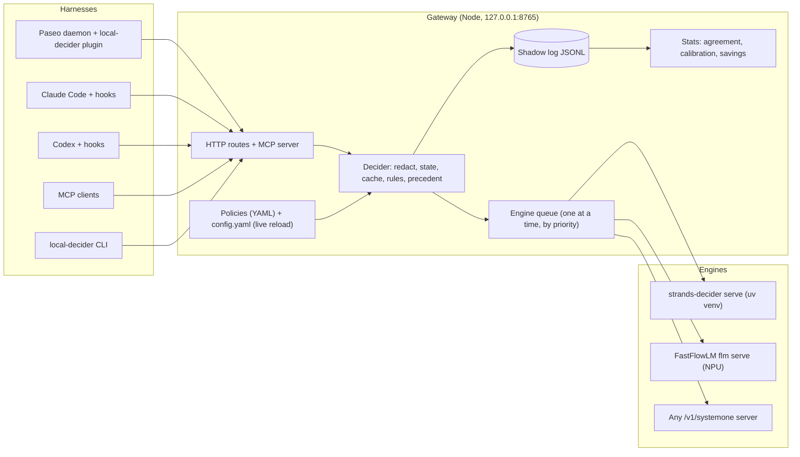
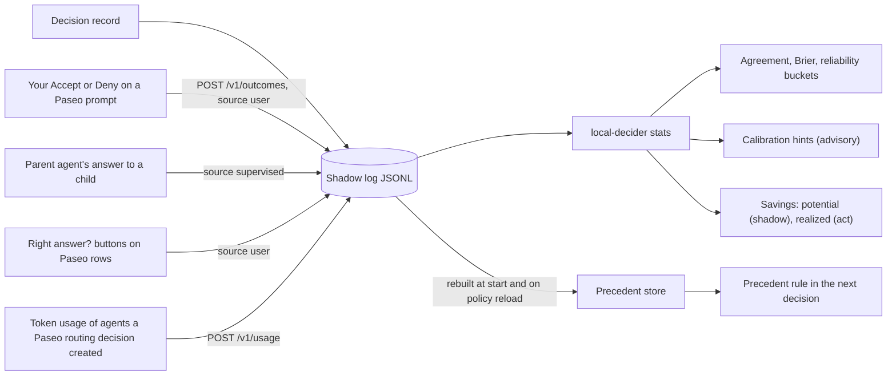

# Architecture

local-decider puts a small local decision model in front of routine, fixed-choice decisions in
coding-agent harnesses. This page shows the pieces and how one decision flows through them. The
reasons behind each choice are in the [ADRs](adr/) and [research notes](research/).

## Components

| Piece | Path | What it does |
|---|---|---|
| Core | `packages/core` | `/v1/systemone` types and answer normalisation, policy schema and rules, redaction, truncation, gateway client |
| Gateway | `packages/gateway` | HTTP service, engine supervisor, decider, shadow log, stats, MCP server, `local-decider` CLI, service units |
| Hooks | `packages/hooks` → `plugins/local-decider/dist/hook.mjs` | One zero-dependency hook runner for Claude Code and Codex, with the deterministic guard |
| Paseo plugin | `packages/paseo-plugin` | Hooks, decision rows, settings and status screens; never runs a model in-process |
| Policies | `policies/` | Default policies and eval fixtures |

## One decision

Step by step:

1. **Policy and mode.** The gateway looks up the policy and its effective mode (`config.yaml`
   beats the YAML file). A selected variant answers with its own questions and rules. `off`
   returns `abstain` without calling an engine.
2. **Redact and shape.** Every input string is redacted (`core/redact.ts`). The state sections
   are rendered in policy order, objects as key-sorted JSON, and trimmed to `state.maxTokens`
   (`core/truncate.ts`).
3. **Engine.** Answers are cached by input hash for the policy's `cache.ttlSeconds`. Otherwise the
   request joins the engine queue: one request at a time, `high` priority policies first, at most
   8 waiting. A full queue, an engine error or the deadline (`decisionTimeoutMs`, 30 s) returns an
   `error` with the policy default and `enforced: false`.
4. **Rules.** The first matching rule wins. A precedent rule also needs enough recent allows of
   the exact subject and no deny ([policies.md](policies.md#precedent)).
5. **Log and answer.** `enforced = mode is act and no error`. A shadow decision keeps running
   after the caller gives up, so it is still logged.

Adapters change behaviour only when `enforced` is true, and only in ways their event allows:

| Adapter | Event → policy | What an enforced action can do |
|---|---|---|
| Paseo | `agent.turn.after` → `turn-outcome` | Highlight `notify` in the chat row; never sends a prompt |
| Paseo | `agent.permission.before` → `permission` | Auto-allow a tool request; never denies |
| Paseo | `agent.create.before` → `routing` | Switch provider, model, mode and thinking, or start from a profile (~2 s budget) |
| Claude Code | `PreToolUse` → guard, then `command-risk` | `deny` or `ask` |
| Codex | `PreToolUse` → guard, then `command-risk` | `deny` only |
| Claude Code, Codex | `PermissionRequest` → `permission` | `allow` only |
| Claude Code, Codex | `UserPromptSubmit` → `routing` | Add a hint that names the mapped model |
| Claude Code, Codex | `Stop` → `turn-outcome` | Nothing: logged only, since Stop output would continue the turn |

The Paseo plugin needs both the gateway mode and its own setting at `act`. Inside Paseo, Claude
Code and Codex agents also load the hooks. The Paseo plugin sets
`LOCAL_DECIDER_HOST_POLICIES=turn-outcome,permission,routing` on agents it opens, so the hooks
skip those and run only the guard and `command-risk`.

## Outcomes, usage and stats

- **Records.** `decision` records hold the input hash, a precedent key (a hash of policy,
  project and redacted subject), answers, action, model and latency. `outcome` and `usage`
  records join them by `decisionId`. No state text is logged. Files:
  `~/.local/share/local-decider/logs/decisions-YYYY-MM-DD.jsonl`.
- **Who reports.** Only the Paseo plugin reports outcomes and usage today. The Claude Code and
  Codex hooks cannot see the user's answer.
- **Calibration hints.** For probability-based allow rules, `stats` may suggest a lower threshold
  when at least 100 escalated, labelled decisions meet it and the Wilson 95% upper bound on the
  deny rate is at most 2%. It never changes the config.
- **Savings.** A routing request may carry `models: {requested, routes, profiles}`. The gateway
  fills missing routes from `config.yaml` presets and resolves a `profile` preset through
  `profiles`. With usage reported, stats sum the tokens of tasks routed to another model, priced
  when `pricing` is set. Shadow savings are an upper bound.
- **Prompt time.** For allow policies, stats show prompts you answered that the policy would have
  allowed, and how long they waited (capped at 10 minutes each).

## Engines

| Engine | What it runs |
|---|---|
| `strands-decider` | Spawns `strands-decider serve <model> --device cpu\|mlx\|mps\|cuda` from the managed uv venv, or attaches to `engine.url` |
| `fastflowlm` | Spawns `flm serve --decision <model>` on the AMD XDNA NPU (Linux), or attaches to `engine.url` |
| `systemone-remote` | Any `/v1/systemone` server at `engine.url`, with an optional bearer token from `tokenEnv` |

- **Supervision.** A spawned engine runs on a free loopback port and logs to
  `logs/engine-<id>.log`. After a crash it restarts with exponential backoff, at most 5 times; a
  5-minute healthy run resets that budget.
- **Lifecycle.** `lazy` (default) loads the model on the first decision and unloads it after
  `idleUnloadMinutes` (15). `eager` loads it at start. A decision that arrives while the model
  loads waits for it.
- **Limits.** Engine responses over 1 MiB are rejected while streaming.
- **Switching.** `POST /v1/engine`, `local-decider engine install` and the Paseo settings page
  switch strands-decider and FastFlowLM models at runtime; the choice is saved as `selection`.
  A remote or `engine.url` engine cannot switch (409).

## HTTP routes

| Route | Purpose |
|---|---|
| `POST /v1/decide/:policy` | Run a policy on harness input |
| `POST /v1/systemone`, `POST /invocations` | Pass-through to the active engine (keys sorted, secrets redacted) |
| `POST /v1/outcomes`, `POST /v1/usage` | Report what happened, and token usage, for a decision |
| `GET /health`, `GET /ping`, `GET /v1/stats` | Engine state and latency; stats as JSON |
| `GET /models`, `GET /v1/engines`, `POST /v1/engine`, `/v1/engine/load`, `/unload`, `/lifecycle` | Model catalogue, engine status, switching and lifecycle |
| `POST /v1/models/download`, `/v1/engines/validate`, `/v1/paths` | Downloads, `flm validate`, tool paths (loopback gateway only) |
| `GET /v1/policies`, `POST /v1/policies/:id/mode`, `/variant`, `/thresholds`, `/v1/policies/reload` | Policy settings, written to `config.yaml` |
| `GET /v1/policies/:id/prompt`, `GET /v1/config`, `POST /v1/config/reload`, `POST /v1/routing/presets` | Authoring prompt, config view and reload, preset mapping |
| `POST /mcp` | MCP over streamable HTTP with `decide` and `policies` tools; `local-decider mcp` is the stdio form |

Security controls on these routes are in [security.md](security.md).
