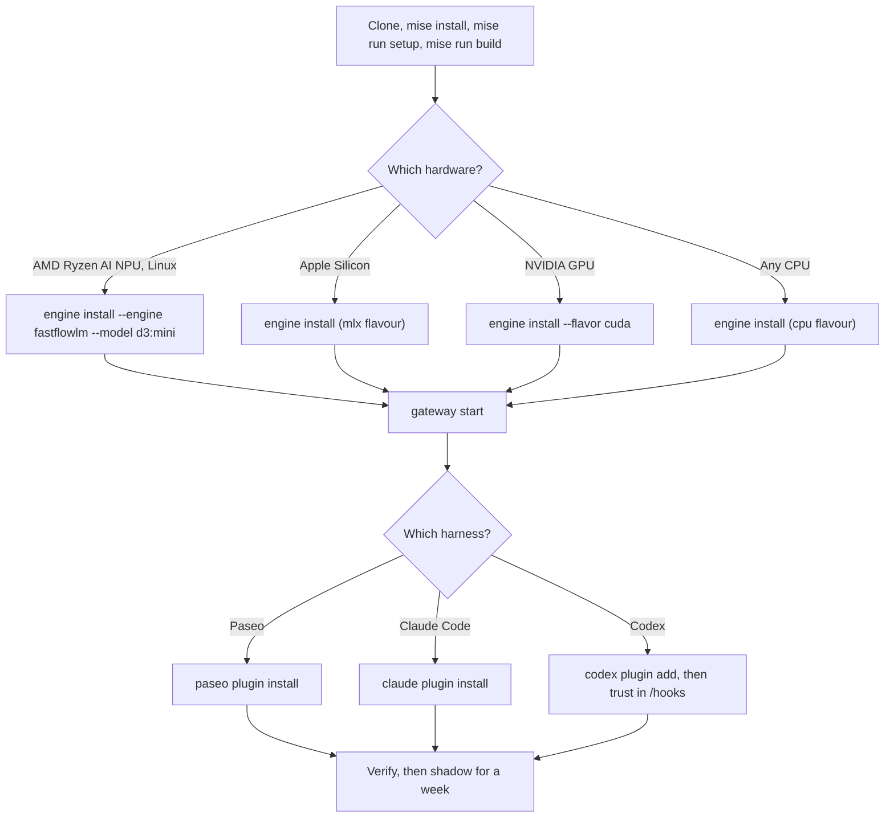

# Install and try it

You need the gateway with one engine, then the plugin for each harness you use. Every policy
starts in `shadow`, so nothing changes until you switch one to `act`. The commands are
fish-compatible.



## 1. Gateway

Requirements: Node >= 24 and [uv](https://docs.astral.sh/uv/). `mise install` provides both. The
packages are not on npm yet, so install from a checkout:

```sh
git clone https://github.com/SkeLLLa/local-decider.git; and cd local-decider
mise trust; and mise install; and mise run setup; and mise run build
alias local-decider "node $PWD/packages/gateway/dist/cli.js"
```

## 2. Engine

Pick one. You can switch later in Paseo's settings or with `POST /v1/engine`.

| Hardware | Command | Default model | Notes |
|---|---|---|---|
| Any CPU (Linux default) | `local-decider engine install` | 2B, ~4.8 GB download | 1.2–2.5 s per short decision |
| Apple Silicon (macOS default) | `local-decider engine install` | 2B on MLX | `--flavor mlx` is picked for you |
| NVIDIA GPU | `local-decider engine install --flavor cuda` | 2B | `device: auto` lets strands-decider pick; or set `engine.device: cuda` |
| AMD Ryzen AI NPU (Linux) | `local-decider engine install --engine fastflowlm --model d3:mini` | `d3:nano` without `--model` | 0.25–0.6 s per short decision (measured on one machine) |

- **strands-decider** syncs a pinned uv project into
  `~/.local/share/local-decider/venvs/strands-decider` and downloads the weights into the Hugging
  Face cache. Flags: `--flavor cpu|mlx|cuda`, `--model <id>`, `--no-download`.
- **FastFlowLM** downloads the pinned portable build (1.0.12) into
  `~/.local/share/local-decider/engines/fastflowlm/`, checks it against GitHub's published
  SHA-256, runs `flm validate` and pulls the model. Then select it in **Settings → Local
  decider**, or run:

  ```sh
  curl -s -H 'content-type: application/json' -d '{"engine":"fastflowlm","model":"d3:mini"}' http://127.0.0.1:8765/v1/engine
  ```

  An `flm` already on `PATH` is found automatically. Tool paths and model directories can be set
  under `tools:` and `dirs:` in `config.yaml` or in the settings page.

## 3. Start the gateway

```sh
local-decider gateway start       # systemd user unit (Linux) or launchd agent (macOS)
local-decider gateway status
```

- `gateway start` writes `~/.config/systemd/user/local-decider.service` or
  `~/Library/LaunchAgents/dev.local-decider.gateway.plist` and starts it. It is a no-op when the
  gateway already runs. Without systemd it starts a detached process with a pid file.
- Also: `gateway restart`, `gateway stop`, `gateway uninstall`, and `gateway run` in the
  foreground.
- The engine loads lazily on the first decision (about 5 s on FastFlowLM, longer on CPU) and
  unloads after 15 idle minutes. Set `lifecycle: {mode: eager}` to keep it loaded.
- Logs: `~/.local/share/local-decider/logs/` (`gateway.log`, `engine-<id>.log`,
  `decisions-YYYY-MM-DD.jsonl`).
- Decision logs are retained for 365 days by default. Set `logs.retainDays` to a value from 90
  to 3650 to change this. Engine logs rotate at 10 MiB and retain one previous file.
- When upgrading from a release that logged unfiltered engine output, delete old engine logs:
  `~/.local/share/local-decider/logs/engine-*.log`.

## 4. Harness plugins

**Paseo.** Enable plugins on the daemon (**Settings → Plugins → Enable plugins**), then:

```sh
paseo plugin install github:SkeLLLa/local-decider:packages/paseo-plugin
paseo plugin ls                   # local-decider should show "running"
```

Details: [Paseo plugin README](../packages/paseo-plugin/README.md).

**Claude Code.**

```sh
claude plugin marketplace add SkeLLLa/local-decider; and claude plugin install local-decider@local-decider
```

**Codex.** Codex runs plugin hooks only after you trust them: open the TUI and run `/hooks`.

```sh
codex plugin marketplace add SkeLLLa/local-decider; and codex plugin add local-decider@local-decider
```

Details: [Claude Code and Codex plugin README](../plugins/local-decider/README.md).

## Verify it works

```sh
local-decider gateway status      # service active, gateway "status":"ok"
local-decider decide turn-outcome lastMessage="All tests pass; the PR is open."
local-decider policies eval permission policies/fixtures/permission.jsonl
local-decider stats
```

- `decide` prints the answers, the action and `"enforced": false` (shadow).
- `policies eval` prints one line per fixture: expected action, returned action, probability.
- `stats` shows one block per policy once a harness has sent decisions. Use a harness for a few
  minutes and run it again.

In Paseo, a decision row appears in the chat after each agent turn. If nothing happens, check
`local-decider gateway status` and `paseo plugin logs local-decider`.

## Your first week

1. **Shadow.** Leave every policy in `shadow` and work normally. Every decision is logged with
   what it *would* have done.
2. **Label.** In Paseo, answer permission prompts as usual and use the "Right answer?" buttons
   on turn rows. Those are the ground truth for stats. (The Claude Code and Codex hooks cannot
   report outcomes.)
3. **Read stats.** `local-decider stats`, or the statistics screen in Paseo. Look at accuracy in
   the high-confidence buckets, the calibration hints, and the would-allow prompt time.
4. **Act.** When the high-confidence buckets are accurate, switch one policy:

   ```sh
   local-decider policies mode permission act
   ```

   In Paseo also set that policy to `act` in **Settings → Local decider**. Lower
   `verdict.allow` (for example to 0.9) only if stats support it.

## Configuration

Every setting lives in `~/.config/local-decider/config.yaml`; all keys are optional.
`local-decider config path` prints the location and `local-decider config check` validates it
and every policy. The gateway applies edits live; only `host`, `port`, `engine` and
`decisionTimeoutMs` need a restart. It writes JSON Schemas for `config.yaml` and policy files to
`~/.config/local-decider/schemas/` (`local-decider config schema`), so editors and agents can
validate edits.

```yaml
# yaml-language-server: $schema=schemas/config.schema.json
host: 127.0.0.1          # anything else requires LOCAL_DECIDER_TOKEN (>= 16 chars)
port: 8765
decisionTimeoutMs: 30000 # per decision, queue wait included
logs: { store: jsonl, retainDays: 365 } # store: jsonl (default) | sqlite
engine:
  type: strands-decider  # or fastflowlm, or systemone-remote with url and tokenEnv
  model: StrandsAgents/strands-decider-2B-qwen3.5-v1-2610
  device: auto           # auto | cpu | mlx | mps | cuda
  # url: http://127.0.0.1:8000   # attach to a running server instead of spawning one
selection: { engine: fastflowlm, model: d3:mini }   # set by the settings page; beats engine.type/model
lifecycle: { mode: lazy, idleUnloadMinutes: 15 }
policies:
  permission: { mode: shadow, thresholds: { verdict.allow: 0.95 } }
  routing: { mode: act, variant: routing-budget }
policyDirs: []           # extra dirs; ~/.config/local-decider/policies is added automatically
routing:
  presets:
    paseo:
      cheap: { model: claude/haiku }
      premium: { model: codex/gpt-5.5, mode: full-access }
      deep: { profile: design-opus }   # Paseo only: an agent profile id
    claude-code:
      cheap: { model: haiku }
pricing:                 # optional, USD per million tokens; never fetched, copy list prices
  claude-haiku-4-5: { input: 1, cachedInput: 0.1, output: 5 }
```

See [policies.md](policies.md) for thresholds, variants and routing presets.

### Log storage and portability

JSONL remains the default. To opt in to SQLite, set `logs.store: sqlite`; the gateway creates
`~/.local/share/local-decider/decider.db` and imports existing daily JSONL files once. The
database and data directory use file modes 0600 and 0700. SQLite is hash-only like JSONL and does
not encrypt data at rest.

```sh
local-decider logs backup ~/local-decider-backup.db
local-decider logs export ~/local-decider-export
local-decider logs export --since 2026-01-01 ~/local-decider-export
local-decider logs import ~/old-local-decider-logs
```

`backup` writes a consistent SQLite snapshot. `export` writes daily `decisions-YYYY-MM-DD.jsonl`
files. `import` is idempotent and leaves the source files in place. These commands require
`logs.store: sqlite`.

### Remote gateway

Secrets never go in `config.yaml`. To bind a non-loopback address, put
`LOCAL_DECIDER_TOKEN=...` (at least 16 characters) in `~/.config/local-decider/env` with mode
0600; the systemd unit reads it if present. Clients read `LOCAL_DECIDER_TOKEN` and
`LOCAL_DECIDER_URL` from their environment and send the token only over https or to a loopback
address. Read [security.md](security.md) first.
