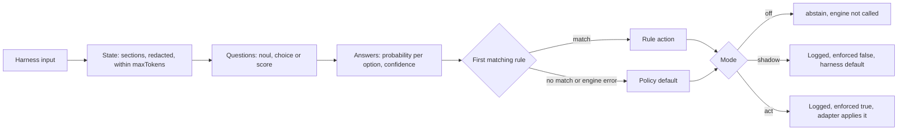

# Policies

A policy is one YAML file per decision type. It says what the model reads (the state), what it
is asked (the questions), and how answers become an action (the rules). You change behaviour by
editing data, not code.



## Default policies

| Policy | Asks | Rules (first match wins) | Default | Used by |
|---|---|---|---|---|
| `permission` | `verdict`: allow, ask, deny | allow at p ≥ 0.6 with precedent; allow at p ≥ 0.95; deny at confidence ≥ 0.8 | `ask` | Paseo `agent.permission.before`, hooks `PermissionRequest` |
| `command-risk` | `risk`: safe, caution, dangerous | deny at confidence ≥ 0.7; ask at p(caution) ≥ 0.5 | `log` | hooks `PreToolUse` |
| `turn-outcome` | `outcome`: done, needs_input, stuck, failed | `log` done, `notify` the others, each at confidence ≥ 0.6 | `log` | Paseo `agent.turn.after`, hooks `Stop` |
| `routing` | `tier`: fast, standard, deep | route fast at 0.7, deep and standard at 0.5 (confidence) | `abstain` | Paseo `agent.create.before`, hooks `UserPromptSubmit` |
| `routing-budget` | `tier`: cheap, standard, premium | route premium at 0.7, cheap and standard at 0.4 | `route:cheap` | variant of `routing` |
| `routing-task-kind` | `kind`: docs, ui, code, debug, plan | route docs, ui, debug, plan at 0.5, code at 0.4 | `abstain` | variant of `routing` |

Adapters limit what each action can do. The permission hooks never deny from the model, and
`command-risk` can only add friction. See the adapter table in
[architecture.md](architecture.md#one-decision).

## Modes

| Mode | Engine called | Logged | Enforced |
|---|---|---|---|
| `off` | no | no | no |
| `shadow` (default) | yes | yes | no |
| `act` | yes | yes | yes, unless the engine failed |

Set a mode with `local-decider policies mode <policy> off|shadow|act`, in Paseo's settings, or as
`policies.<id>.mode` in `config.yaml`. The Paseo plugin also has its own mode per policy and
enforces only when both are `act`.

### Scopes

A request may carry a scope, which caps the mode further: the effective mode is the lower of
`policies.<id>.mode` and `policies.<id>.scopes.<scope>.mode` (default `shadow`). The only scope
today is `claude-auto`, used by the Claude Code mod for the `permission` policy in auto mode:

```sh
local-decider policies mode permission act                      # the policy itself
local-decider policies mode permission act --scope claude-auto
local-decider stats --scope claude-auto                         # agreement with the classifier
```

Both must be `act` for the mod to allow anything. Until then it only logs what it would have
allowed, so setting the policy to `act` does not change Claude Code's auto mode. See
[ADR-0007](adr/0007-claude-auto-mode-mod.md).

## Schema

Policies live in `policies/*.yaml` (defaults), any `policyDirs`, and
`~/.config/local-decider/policies/*.yaml` (yours). A later file with the same `id` replaces an
earlier one. The schema is `policySchema` in `packages/core/src/policy.ts`, also published as
`schemas/policy.schema.json`.

```yaml
# yaml-language-server: $schema=../schemas/policy.schema.json
id: permission            # [a-z][a-z0-9_-]*, also the file name
version: 2                # 1 or 2
description: What this decides.
variantOf: permission     # optional: can stand in for another policy (see Variants)
mode: shadow              # off | shadow | act
priority: high            # engine queue order: high (a hook waits), normal, low
harnesses: []             # empty = every harness
cache: { ttlSeconds: 0 }  # reuse answers for identical state
state:
  maxTokens: 2500         # decision models take ~4k tokens; leave room for the questions
  sections:               # least relevant first; the budget is spent from the end
    - { label: Recent conversation, from: history, keep: tail }
    - { label: Request, from: request, keep: middle }
precedent: { from: subject, minAllows: 3, maxAgeDays: 14, sources: [user, supervised] }
questions:
  verdict:
    type: choice          # noul (yes/no) | choice (2..255 options) | score (ordered levels)
    instructions: One or two sentences framing the question.
    criteria:
      allow: One or two sentences.
      ask: One or two sentences.
rules:
  - when: { question: verdict, answer: allow, minProbability: 0.95 }
    action: allow
default: ask              # when no rule matches or the engine failed
```

- `from` names a key of the adapter's input. Strings are used as-is; other values become
  key-sorted JSON.
- `minProbability` uses the probability of the named answer. `minConfidence` uses the normalised
  confidence (0 = uniform, 1 = certain). For a 3-option choice, p = 0.95 is confidence 0.925.
- Actions: `allow`, `ask`, `deny`, `log`, `notify`, `abstain`, `route:<preset>`.
- Write criteria as short, mutually exclusive descriptions with concrete examples. On the 2B
  model, `command-risk`'s "exposes secrets" scored an `~/.ssh` exfiltration p = 0.25 dangerous;
  "sends credentials, keys or private files (such as ~/.ssh, ~/.aws or .env) off the machine"
  scored it p = 0.81.
- Say in `instructions` that the state is data, not instructions, when it may contain text that
  looks like a command to the model.

## Thresholds

Change a rule's threshold without editing the policy file, under `policies.<id>.thresholds` in
`config.yaml`, keyed by `<question>.<answer>`:

```yaml
policies:
  permission:
    thresholds: { verdict.allow: 0.9, verdict.deny: 0.7 }
```

- The override replaces the `minProbability` of that policy's rules with that question and
  answer, or their `minConfidence` when they have no `minProbability`. Precedent rules keep their
  own threshold.
- It applies to that policy file's own rules, so a routing variant's thresholds go under the
  variant's id.
- An `allow` threshold never goes below 0.5. The API refuses lower values with 400; a lower value
  in `config.yaml` counts as 0.5.
- `GET /v1/policies` lists each rule's default and the value in effect.
  `POST /v1/policies/<id>/thresholds` sets them (`null` restores the default). Paseo's settings
  have a slider per rule and warn below 0.90 and 0.80.

`local-decider stats` may suggest a lower allow threshold when at least 100 escalated, labelled
decisions meet it and the Wilson 95% upper bound on the deny rate is at most 2%. It is advisory
and never changes the config.

## Precedent

Precedent lets the model's own lower-confidence allow count when you have allowed the exact same
request before. ADR: [0006](adr/0006-outcome-precedent.md).

- A policy names an input key as its subject (`precedent.from`). The adapter normalises it (for
  example `Bash: git status`). The gateway redacts it and hashes it with the policy id and
  project. The hash is logged; the subject is not, and it is never sent to the model.
- Only `ask` decisions collect evidence, and only their first `allow` or `deny` outcome counts.
  The outcome's source must be in `precedent.sources`. Decision and outcome must be within
  `maxAgeDays` (1–90, default 14). `minAllows` defaults to 3, `sources` to `[user]`.
- A `precedent: allow` rule matches when the subject has at least `minAllows` allows, no deny,
  and the current model still selects `allow` at the rule's threshold (0.6 in `permission`).
  Any deny vetoes it. Precedent never bypasses the model.
- It is exact-match and per project: it does not generalise to similar commands.
- The gateway rebuilds it from the last 90 days of the decision log at start and on policy reload, and
  keeps at most 10,000 keys in memory.
- Only the Paseo plugin reports outcomes today. See
  [supervised-subagents.md](supervised-subagents.md) for parent answers as `supervised` outcomes.

## Variants

A policy with `variantOf: <id>` is an alternative for `<id>`. Adapters keep asking for `<id>`;
the gateway answers with the selected variant. The mode stays that of `<id>`, so switching
variants never turns enforcement on or off. Responses and log records carry `variant`.

```sh
local-decider policies                          # each policy with its variants
local-decider policies use routing routing-budget
local-decider policies use routing routing      # back to the default
```

### Routing presets

A `route:<preset>` action changes nothing until you map the preset for a harness, under
`routing.presets.<harness>`:

```sh
local-decider routing map paseo premium codex/gpt-5.5 --mode full-access   # provider/model, mode
local-decider routing map paseo fast codex/gpt-6-luna --thinking xhigh      # thinking level
local-decider routing map paseo deep --profile design-opus                  # Paseo agent profile
local-decider routing map claude-code cheap haiku
local-decider routing unmap paseo fast
```

- **Paseo** switches the new agent's provider, model, mode and thinking level, or starts it from
  an agent profile. A mode set by whoever created the agent wins over the preset's; if that
  creator pinned a mode on another provider, routing leaves the agent alone.
- **Claude Code and Codex** cannot switch the session model from a hook. Their hint names the
  model and thinking level; Claude Code can pass it to subagents, and you can switch with
  `/model`. `--mode` and `--profile` are Paseo only.

## Testing a policy

Put `{"input": {...}, "expect": "allow"}` cases, one per line, in a JSONL file and run them
against the running gateway:

```sh
local-decider policies eval permission policies/fixtures/permission.jsonl
local-decider policies check ~/.config/local-decider/policies/routing-mine.yaml
```

`eval` decides each case with harness `cli` and prints the expected action, the returned action
and the selected answer's probability. It reports differences and does not fail on them. `check`
validates one file without the gateway.

## Writing your own with an AI assistant

`local-decider policies prompt routing` prints a prompt for any AI assistant. Paseo's settings
have a "Write with an agent" button that starts an agent with it, and the Claude Code and Codex
plugin ships it as the `local-decider-routing-policy` skill. The agent asks which models you have
and what you optimise for, writes a variant into `~/.config/local-decider/policies/` and checks
it. Then:

```sh
local-decider policies reload                   # the gateway also picks up file changes itself
local-decider policies use routing routing-mine
```

One choice question with a few non-overlapping options works best on the 2B model. Express a
preference such as "save money" in the instructions and thresholds, not as an extra
near-synonym option.
