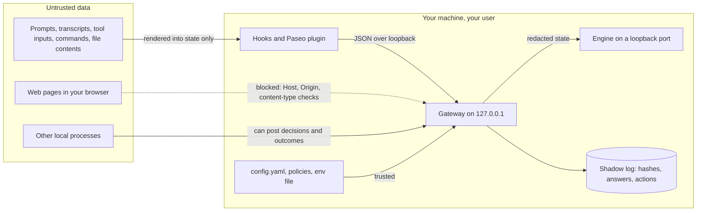

# Threat model and known limits

local-decider reads text an agent or an attacker may control, and can auto-allow actions. This
page says what it trusts, what it protects, and what it does not.

## Trust boundaries

- **Untrusted:** everything an agent or tool produces, and so everything adapters send to the
  gateway.
- **Trusted:** your `config.yaml`, policy files and env file, and the pinned engine environment.

## What it protects

| Control | Detail |
|---|---|
| Loopback only by default | The gateway binds `127.0.0.1`. Any other address needs `LOCAL_DECIDER_TOKEN` (at least 16 characters); requests must then send it as a bearer token. |
| Token handling | The token is read from the environment, never stored in settings or logged. Clients, the Paseo plugin and the remote engine send it only over https or to a loopback host. |
| Browser defences | Without a token, the Host header and any Origin must be loopback, and every POST must be `application/json`. This blocks cross-site requests and DNS rebinding. |
| Untrusted input is data | Input is only rendered into the model's state. It is never executed or used as a path, URL, engine argument or a policy id outside the loaded set. Engine argv comes from validated config. |
| Redaction | Keys, tokens, JWTs, private keys, URL credentials and `password=`-style assignments are redacted before the engine sees the state (`core/redact.ts`). |
| No text in logs | The shadow log stores an input hash, answers and actions, never state text. |
| Bounded work | Request bodies are capped at 256 KiB, engine responses at 1 MiB, the queue at 8 waiting decisions, and each decision has a deadline. Unparsable request targets get 400. |
| Fail open | Adapters act only on `enforced` decisions. Any error, timeout or unreachable gateway means the harness default. Policies ship in `shadow`. |
| Limited actions | Auto-allow needs p(allow) ≥ 0.95 (floor 0.5 for overrides). `command-risk` can only ask or deny. Permission hooks never deny from the model. |
| Deterministic guard | Before any model, the hooks deny a short list of destructive shell commands, including inside `bash -lc` scripts, Codex argv arrays and `sudo` prefixes. A model cannot override it. |
| Remote tool paths | Tool paths can only be changed on a loopback gateway. |

## What it does not protect against

- **Prompt injection.** The model reads attacker-controllable text. It cannot run tools, but it
  can be steered toward a label. The controls above limit what a wrong label can do; they do not
  make the label right.
- **Redaction gaps.** Redaction is pattern matching. Unusual secret formats reach the local
  engine (still never the log).
- **Forged outcomes.** Any local process can post an outcome to the loopback gateway, so labels
  are not tied to a user or harness. Forged allows could build precedent for an exact repeated
  request.
- **Bad supervision.** A `supervised` outcome inherits the parent agent's judgement. Inconsistent
  parent answers teach inconsistent precedent.
- **Model drift.** Calibration is per model. Thresholds tuned on one model do not transfer;
  re-check `local-decider stats` after switching.
- **A compromised user account.** Anything running as you can edit `config.yaml` and the
  policies.

## Known limits

- **CPU latency.** On CPU the 2B model takes seconds per decision, longer than the hooks' 1.5 s
  budget. There it suits shadow logging, turn outcomes and routing hints.
- **Claude Code auto mode** ignores a hook `allow`
  ([anthropics/claude-code#94740](https://github.com/anthropics/claude-code/issues/94740)).
- **Service node path.** The systemd unit and launchd plist pin the absolute path of the node
  that ran `gateway start`. After removing that node version, run `gateway start` again.
- **Paseo 0.15.3** passes no first prompt to `agent.create.before`, so routing sees only the
  agent title.
