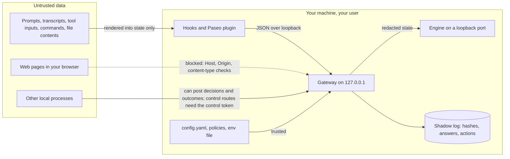

# Threat model and known limits

local-decider reads text an agent or an attacker may control, and can auto-allow actions. This
page says what it trusts, what it protects, and what it does not.

## Trust boundaries

- **Untrusted:** everything an agent or tool produces, and so everything adapters send to the
  gateway.
- **Trusted:** your `config.yaml`, policy files and env file, and the pinned engine environment.

## What it protects

| Control | Detail |
|---|---|
| Loopback only by default | The gateway binds `127.0.0.1`. Any other address needs `LOCAL_DECIDER_TOKEN` (at least 16 characters); requests must then send it as a bearer token. |
| Token handling | The bearer token is read from the environment, never stored in settings or logged. The Paseo daemon sends it to loopback or to its pinned HTTPS origin. The CLI, core client and Paseo daemon refuse redirects. |
| Control token | At first start the gateway creates `<config dir>/control-token` from 32 random bytes, in mode 0600, and atomically publishes it with a hard link, falling back to exclusive file creation when hard links are unavailable. It must be exactly 43 base64url characters. Startup refuses malformed files and files readable by group or other users. The CLI and Paseo daemon read it; agents and the Claude Code mod do not. The `x-local-decider-control` header guards control and config routes. |
| Browser defences | Without a token, the Host header and any Origin must be loopback, and every POST must be `application/json`. This blocks cross-site requests and DNS rebinding. |
| Untrusted input is data | Input is only rendered into the model's state. It is never executed or used as a path, URL, engine argument or a policy id outside the loaded set. Engine argv comes from validated config. |
| Redaction | Keys, tokens, JWTs, private keys, URL credentials, `password=`/`--token`/`mysql -p` style arguments and the values of secret-named fields (`password`, `authorization`, `cookie`, `*_token`, …) are redacted before the engine sees the state (`core/redact.ts`). Redaction is best effort: it may over-redact the rest of a line or string when the surrounding quote is not adjacent to the key, and it misses shapeless secrets, `.netrc`, spaced `mysql -p x` and comma tails in `password: a,b`. |
| No text in logs | The shadow log stores an input hash, answers and actions, never state text. Engine stdout/stderr lines containing `"state"` or `"questions"`, and lines over 500 characters, are dropped before logging. |
| Bounded log storage | Engine logs rotate at 10 MiB with one previous file retained. Decision logs are pruned according to `logs.retainDays` (90–3650 days, default 365). SQLite files use mode 0600 inside the mode 0700 data directory. |
| Bounded work | Request bodies are capped at 256 KiB, engine responses at 1 MiB, the queue at 8 waiting decisions, and each decision has a deadline. Unparsable request targets get 400. |
| Fail open | Adapters act only on `enforced` decisions. Any error, timeout or unreachable gateway means the harness default. Policies ship in `shadow`. |
| Limited actions | Auto-allow needs p(allow) ≥ 0.95 (floor 0.8 for non-precedent overrides). `command-risk` can only ask or deny. Permission hooks never deny from the model. |
| Deterministic guard | Before any model, the hooks deny a short list of destructive shell commands, including inside `bash -lc` scripts, Codex argv arrays and `sudo` prefixes. A model cannot override it. |
| Auto mode scope | The `claude-auto` scope caps the `permission` policy at `shadow` unless you raise it. The mod allows only in auto mode, only a plain ask, and only after a deterministic path and command check. |
| Remote tool paths | In remote mode (`LOCAL_DECIDER_TOKEN` set), paths, engine connections, discovery and routing presets stay frozen, so a bearer cannot make the host run binaries or reach new URLs. Loopback writes need the control token. |

## Outcomes

At startup the gateway creates `<config dir>/report-token` if needed, using 32 random bytes and
file mode 0600. The Paseo plugin server reads it from the same config directory and sends it only
with outcome reports, and only to loopback gateways. The Claude Code and Codex hooks do not
read or send this token. Reports
without a matching token are still logged as `source: unverified` and `verified: false`, and still
count in agreement and reliability statistics; only verified outcomes can update precedent or
calibration hints.

Labels can only add vetoes; no outcome or label path creates allow evidence on an auto-allowed
decision. The Paseo daemon labels only rows it drew itself: the label RPC names a row, and the
decision, agent and answer time come from daemon state, within 24 hours.

The report token does not stop an agent running as the same user without a sandbox from reading
the file and forging a verified report. Any local token helps only when filesystem isolation keeps
the other process from reading the config directory. Claude Code and Codex sandboxes can provide
that isolation when configured to deny reads outside the workspace.

## Token scoping

The Paseo bearer goes only to loopback or to the HTTPS origin named by
`LOCAL_DECIDER_TOKEN_ORIGIN` in the daemon environment. The pin must match the gateway origin;
default ports are not normalised (`https://gw.example` differs from `https://gw.example:443`), and
a trailing-dot host differs from the same host without the dot. These cases withhold the token.
The report and control tokens go to loopback only. Requests from the CLI, core client and Paseo
daemon use `redirect: 'error'`. Agent MCP configuration carries no tokens, and MCP injection is
skipped when the gateway is remote or needs a bearer token.

## What open routes disclose

`/health` and `/ping` return engine state, model and `detail`. Detail can contain the engine URL's
scheme, host, port and path, but not its userinfo or query; it can also contain upstream error
text. Inference routes return engine error messages. Fixed public diagnostics are follow-up F7.

## Decision log storage

Decisions are stored in SQLite as hashes, answers, actions, outcome labels and numeric usage
data. It stores no state, subject or prompt text. The
database is `~/.local/share/local-decider/decider.db`, mode 0600, in a mode 0700 data directory.
SQLite does not encrypt data at rest; access is controlled by the operating system file
permissions. WAL mode permits read-only handles while the gateway writes. The gateway holds a pid
lock at `<run>/db.lock`, enforcing one writer per data directory. Statistics run in a worker
thread with its own read-only SQLite connection, keeping the synchronous database read off the
gateway event loop. JSONL exports and SQLite backups contain the same sensitive metadata and
should be protected accordingly.

## Engine endpoints

The `openai-compatible` and `systemone-remote` engines send the redacted state to the URL you
configure, so pick one you trust: a non-loopback host sees decision state. The bearer token named
by `tokenEnv` is sent only over `https` or to a loopback address, and is masked in error text.
Engine HTTP clients refuse redirects, so a configured URL cannot bounce the state or token
elsewhere. The gateway does not run anything for these engines: it starts no LM Studio, Ollama or
llama-server process, and model ids from `/models` are used as data only.

Only the name of the token's environment variable is stored in `config.yaml`. Neither the Paseo
form nor `local-decider engine configure` accepts the token value itself. Setup steps are in
[install.md](install.md#openai-compatible-servers).

## What it does not protect against

- **Prompt injection.** The model reads attacker-controllable text. It cannot run tools, but it
  can be steered toward a label. The controls above limit what a wrong label can do; they do not
  make the label right.
- **Redaction gaps.** Redaction is pattern matching. Unusual secret formats reach the local
  engine (still never the log).
- **Forged outcome reports.** An agent running as you without a sandbox can read the
  `report-token` and forge verified outcomes (see [Outcomes](#outcomes)). So can a compromised
  Paseo plugin process.
- **Loopback port takeover.** While the gateway is down, any process that binds its configured
  loopback port can receive requests and the local tokens sent to that port.
- **Bad supervision.** A `supervised` outcome inherits the parent agent's judgement. Inconsistent
  parent answers teach inconsistent precedent.
- **Model drift.** Calibration is per model. Thresholds tuned on one model do not transfer;
  re-check `local-decider stats` after switching.
- **A compromised user account.** Anything running as you can edit `config.yaml` and the
  policies.

## Known limits

- **CPU latency.** On CPU the 2B model takes seconds per decision, longer than the hooks' 1.5 s
  budget. There it suits shadow logging, turn outcomes and routing hints.
- **Claude Code auto mode** ignores a hook `allow`
  ([anthropics/claude-code#94740](https://github.com/anthropics/claude-code/issues/94740)). The
  plugin's `tool.check` mod can allow there once you set the `permission` policy and its
  `claude-auto` scope to `act` ([ADR-0007](adr/0007-claude-auto-mode-mod.md)); it never allows
  before that. In act mode:
  - a mod allow skips the classifier, even a `hard_deny` rule of the classifier;
  - the mod keeps outside-cwd and protected paths, `git push`, publishing, network tools and
    `rm -r` out of its allows, and never touches asks from rules, hooks or settings;
  - Claude Code tells the model "the hook was skipped" on every honoured allow;
  - in Paseo and other host sessions the allow is silently ignored and the classifier decides.
- **Service node path.** The systemd unit and launchd plist pin the absolute path of the node
  that ran `gateway start`. After removing that node version, run `gateway start` again.
- **Paseo 0.15.3** passes no first prompt to `agent.create.before`, so routing sees only the
  agent title.
- **Claude Code mod redirects.** Its `$.http.fetch` API cannot refuse redirects, so the mod cannot
  apply the redirect protection used by the other clients.
- **Remote MCP injection.** Injection is skipped for remote or token-mode gateways until follow-up
  F1 adds a daemon-side tool channel.
